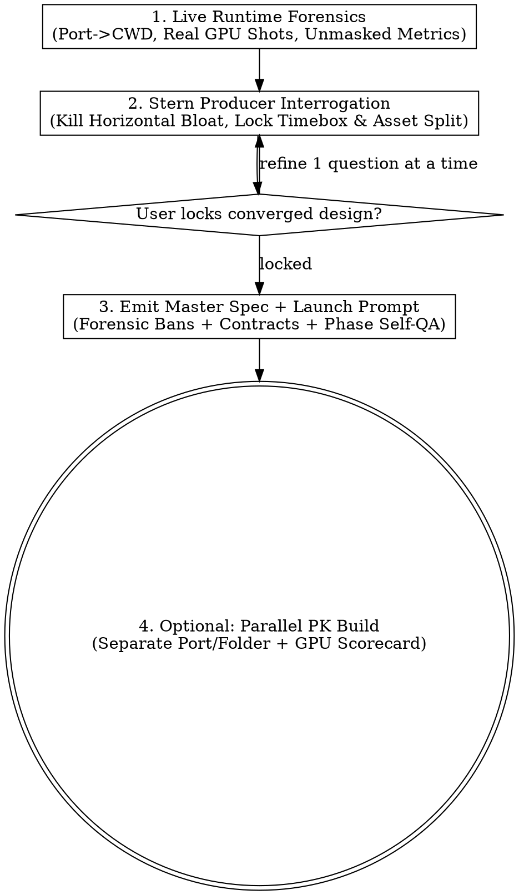

# Critique and Unleash (实机取证批判 → 严厉收敛 → 满血重构流)

## Overview

Turn disappointing AI-generated prototypes ("Look-Test" shells, janky demos, bloated multi-theme messes) into showcase-grade software. Combine **hardware-accelerated runtime forensics**, **stern producer scope surgery**, and **high-autonomy engineering contracts** designed specifically to unlock the ceiling of long-horizon models (such as Claude Fable 5.2) without letting them cut corners.

<HARD-GATE>
Never generate the rebuild prompt/spec or write implementation code until:
1. Phase 1 (Live Runtime Forensics) has captured real browser/runtime evidence, AND
2. Phase 2 (Stern Producer Interrogation) has converged with the user on a timeboxed, high-depth design contract.
</HARD-GATE>

## Workflow

---

## Phase 1: Live Runtime Forensics (真机取证验尸 — 严禁只静态读代码)

1. **Locate the REAL target entry (never guess files):**
   - If given a URL or port, run `scripts/locate_target.sh <port_or_url>` to resolve `PID -> command -> cwd` and list all HTML/route entries.
   - Multi-pivot repos often contain abandoned sibling entries (`index.html` vs `vice.html` vs `earth.html`). Audit **only** the target entry while scanning sibling folders and `docs/` / `prompts/` to understand what existing utilities the previous agent lazily ignored and what "Concept Promise" (卖家秀) it failed to deliver.

2. **Capture hardware-accelerated runtime truth:**
   - Launch Playwright with **real GPU hardware acceleration** (`channel: 'chrome'`, `args: ['--use-angle=metal', '--enable-gpu', '--ignore-gpu-blocklist']`). Never measure FPS or shaders on headless SwiftShader CPU fallback.
   - Capture at least 4 diagnostic views and **visually inspect every screenshot**:
     - **Default entry view** vs original concept art / user expectation;
     - **Structural / overhead view** (pull camera out or inspect full layout to expose "Potemkin village" 1D strips, empty gray void slabs, floating detached elements, or horizon/fog seams);
     - **Interaction & boundary stress** (walk/click straight through walls/objects, test core verbs, check mobile/narrow viewport);
     - **Close-up asset/component inspection** (surface normals, blurry baked textures, broken compression, clipped text).
   - **Audit the telemetry itself for lies:**
     - In Three.js/WebGL, `EffectComposer` passes like `OutputPass` reset `renderer.info` when `autoReset === true`, falsely reporting `calls = 1`. Disable `autoReset` and measure full-frame calls & triangles.
     - Check if FPS is computed from clamped `dt` (`Math.min(0.05, dt)`), which inflates reported FPS during heavy stutter. Always measure wall-clock `performance.now()`.
     - Run quick A/B toggles (e.g., disable full-res `GTAOPass`, lower `DPR`, toggle shadows) to name the **measured** #1 bottleneck rather than guessing.

3. **Deliver a plain-language, surgical critique:**
   - Speak directly in plain, vivid language backed by exact `file:line` links and measured numbers.
   - Contrast **why** top showcase benchmarks (e.g., viral X procedural/shader builds) look and feel 10× better than the current prototype.
   - **Ban timid QA framing:** Never propose "let's freeze features and just fix one street corner of a 138-line shell." Diagnose architectural bankruptcy honestly.

---

## Phase 2: Stern Producer Interrogation & Scope Surgery (严厉制作人审讯与工期收敛)

When the user shares ambitious or scattered ideas (multi-theme mods, multiple art styles, dozens of characters/features), **do NOT sycophantically agree**. Step in as a strict, seasoned Creative & Technical Director:

1. **Crush "Horizontal Bloat as Procrastination" (`宽度逃避深度`):**
   - Expose the math: `20-point unpolished base × 8 themes × 4 art styles = 32 piles of 20-point slop`.
   - Explain why art styles are **not post-processing filters** — geometry bevel scale, material roughness contrast, and lighting chiaroscuro must be unified. Lock **one** showcase visual foundation first; support multi-theme expansion via clean data/grammar **Cartridge (`Mod`) slots** only after the flagship slice hits 95/100.

2. **Enforce Hard Timebox Math:**
   - Ask for (or respect) the hard development budget (e.g., `12 hours`).
   - Allocate **55–65% of budget to optical/visual fidelity, juice, and automated visual polish**, leaving **35–45% for a tight, high-dopamine core loop**. Ruthlessly cut time-sink features that dilute craft, or reframe mechanics into playful, high-leverage physics/state loops.

3. **Enforce the Golden Asset-vs-Code Division (`黄金分工铁律`):**
   - **External AI Asset Generators (Tripo 3D, image/audio gen):** Restrict strictly to **organic characters, creatures, or signature hero tokens** that code cannot cleanly express.
     - Require a **Unified Rig / Interface** across character variants (e.g., all characters share one standard Humanoid Rig + runtime procedural bone IK / spring physics) to prevent `N skeletons × M animations` explosion.
     - Ban lossy `JPEG` compression on normal/data maps during Blender/asset post-processing; cap hero polycounts sensibly and keep procedural fallbacks so external queues never block engineering.
   - **100% Procedural Code & Shaders:** Own all **hard-surface architecture, modular layouts, multi-channel PBR maps (`map` + height `normalMap` + puddle/wear `roughnessMap`), planar/screen reflections, Interior Mapping parallax, `InstancedMesh` rigid-body props, particles, and dynamic WebAudio synthesis**.

4. **Align iteratively (1 focused decision at a time) and lock Battleground Isolation:**
   - Keep the broken original running untouched on its original port as the baseline (`Port A`);
   - Assign the Fable/Claude rebuild to a clean new directory & port (`Port B`);
   - If doing a head-to-head comparison build, assign your own implementation to a third clean directory & port (`Port C`).

---

## Phase 3: Author the Master Spec & Launch Prompt

Load [references/master-spec-template.md](references/master-spec-template.md) and generate two deliverables:

1. **The Master Specification Document (`CLAUDE_<BUDGET>_MASTER_GUIDE.md`)** saved to disk:
   - **Part 1 — Forensic Post-Mortem Bans:** Exact list of bugs, math blunders, asset mistakes, and fake telemetry from Phase 1 that trigger immediate failure if repeated.
   - **Part 2 — Architecture, Asset Division & Scope Contract:** Isolated directory/port, golden asset/code split, cartridge interfaces, and core loop specification.
   - **Part 3 — Technical & Optical Bar:** Concrete rendering, physics batching (`InstancedMesh` / static material merge), animation IK layering, and audio synthesis requirements — **specify outcomes and invariants, NOT restrictive line-by-line pseudocode** (long-horizon models like Fable 5.2 reason far better when given crisp contracts rather than micromanaged boilerplate).
   - **Part 4 — Performance Redlines & 4-Phase Self-Verification Cage:** Unmasked `window.__diag` contract (`>= 60 FPS`, draw-call & triangle ceilings) + mandatory real-GPU Playwright multi-angle screenshot self-review at the end of every phase.

2. **The Copy-Paste Launch Prompt:** A concise, high-authority kickoff prompt pointing the target agent at the Master Guide and instructing it to execute all 4 phases autonomously without stopping early to ask permission.

---

## Phase 4: Parallel Head-to-Head Build (When Requested)

When the user asks you to build a comparison version alongside Fable/Claude:
1. Scaffold the isolated comparison project (`Port C`) and kick off any external organic character jobs asynchronously in the background with lossless texture export.
2. Split implementation across non-overlapping module boundaries (e.g., Optical/World Compiler vs Physics/Actors/Audio) using subagents where available, keeping integration, HUD, and final verification with the lead.
3. Run the **exact same real-GPU Playwright multi-angle visual + unmasked FPS audit** on your own build, fixing every visual seam, floating prop, or frame drop before presenting the side-by-side comparison.

---

## Red Flags — STOP If You Catch Yourself Thinking Any of These

| Rationalization | Reality & Required Fix |
|---|---|
| "I already read `main.js`, I can write the critique without opening a browser." | Static reading misses horizon seams, melted normals, GPU fill-rate collapses, and broken camera angles. Run GPU Playwright first. |
| "`window.stats.calls` says `1` and `fps` says `60`, so performance is great." | Post-processing passes reset `renderer.info`, and clamped `dt` fakes FPS. Verify with `autoReset = false` and wall-clock `performance.now()`. |
| "Let's tell Claude not to add gameplay this round and just fix one street corner." | Timid QA incrementalism turns a dead look-test into a slightly cleaner dead look-test. Redesign a complete, right-sized playable slice. |
| "The user wants 6 countries + 4 art styles + 10 animal skeletons — sounds awesome!" | That is horizontal bloat disguising an unbuilt core. Interrogate sternly and cut to a 95-point vertical core + modular cartridge architecture. |
| "Let's generate buildings, roads, and cars with image-to-3D GLBs for realism." | Single-texture baked AI blobs ruin hard surfaces, glass reflections, and draw budgets. Use procedural hard-surface compilers + decoupled PBR materials. |
