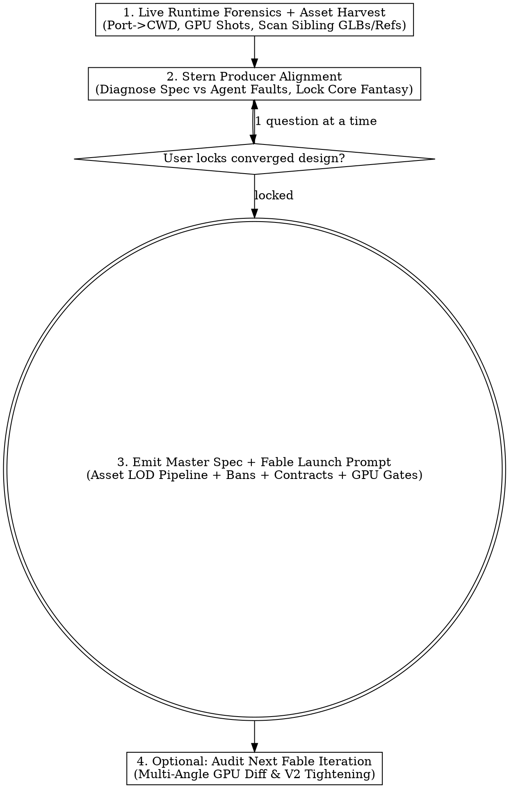

# Critique and Unleash (真机取证批判 → 资产搜刮与严厉收敛 → 榨干 Fable 重构流)

## Overview

Turn disappointing or mediocre AI-generated builds ("Look-Test" shells, boxy `BoxGeometry` demos, toy loops) into showcase-grade software. By default, **you act as the ruthless Lead Creative/Technical Director, Forensic Critic, and Master Spec Architect**, while delegating heavy multi-hour implementation to **Fable / Claude** (only building a parallel comparison version yourself if the user explicitly asks you to code alongside it).

<HARD-GATE>
Never emit the Master Spec / Launch Prompt until:
1. Phase 1 (Live Runtime Forensics + Sibling Asset Harvest) has inspected real GPU screenshots AND scanned neighboring workspace/Desktop/Downloads folders for existing high-detail assets/references; AND
2. Phase 2 (Stern Producer Alignment) has converged with the user on visual bar, asset pipeline, spatial scale, and core interaction depth.
</HARD-GATE>

## Workflow

---

## Phase 1: Live Runtime Forensics & Sibling Asset Harvest (真机验尸 + 全盘搜刮家底)

1. **Locate the REAL target entry & scan neighboring goldmines:**
   - Resolve `<port_or_url>` via `scripts/locate_target.sh <port_or_url>` (`PID -> command -> cwd`).
   - **CRITICAL LESSON — Always scan sibling Desktop / Downloads / parent folders for existing high-value assets (`*.glb`, `*.png`, `STYLE.md`, shaders, reference packs)!** Users frequently have prior cinematic scenes, purchased/Tripo 4K GLB packs, or facade atlases sitting in adjacent folders that the previous agent ignored. Inspect mesh polycounts and bounding orientations (`+X` vs `+Z`) via headless Blender or GLB header inspection before designing the pipeline.

2. **Capture hardware-accelerated runtime truth:**
   - Launch Playwright with **real GPU acceleration** (`channel: 'chrome'`, `args: ['--use-angle=metal', '--enable-gpu', '--ignore-gpu-blocklist']`).
   - Capture and **visually inspect** at least 4 views: default street/entry view, high bird's-eye structural overview (exposes cookie-cutter box blocks, empty borders, pitch-black mud, or detached props), core action/combat/VFX close-up, and `390×844` mobile layout.
   - Audit telemetry honestly (`renderer.info.autoReset = false`, wall-clock `performance.now()`).

3. **Separate "Spec Faults" from "Agent Shortcuts" ruthlessly:**
   - If evaluating a previous AI iteration that feels "mediocre" (`一般`), explicitly distinguish:
     - **Spec-induced ceilings** (e.g., over-banning 3D GLBs and forcing `BoxGeometry` soapbox cars/stick-trees; shrinking maps into tiny `220m` kart loops; substituting toy point-scoring for the genre's real core fantasy);
     - **Agent shortcuts** (e.g., stamping one rectangular apartment generator with swapped hex colors across Egypt/China/Miami; pitch-black `#03040c` night hiding empty ground; 0ms teleport state switches instead of physical animations; blurry `Points` cotton-ball particles).

---

## Phase 2: Stern Producer Alignment & Anti-Mediocrity Laws (反平庸设计收敛)

1. **Enforce the Upgraded Asset-vs-Code Law (`高模多级 LOD 拆件 + 程序化城市骨架`):**
   - **NEVER build complex vehicles, botanical foliage, characters, or hero monuments out of `BoxGeometry` / low-poly `Loft` primitives** when real 3D GLBs or Tripo + Blender are available — primitive cars and 6-triangle palms immediately brand a project as "cheap AI demo" no matter how much wet reflection or Bloom you add.
   - **Raw High-Poly GLB Trap (`100k+ tris`)**: Raw offline Tripo/DCC GLBs often have `80k–120k` triangles per car/tree with fused single meshes. Always mandate an **Automated Blender Batch Compiler (`bpy`)** in Stage 1 that:
     1. Decimates hero vehicles/landmarks into **`LOD0` (`10k–14k` tris, lossless PNG color/normal/ORM + physical clearcoat)** and **`LOD1` (`2.5k–3.5k` tris for distant `InstancedMesh` traffic)**, and foliage/street props into **`3k–5k` tris `InstancedMesh`**;
     2. Geometrically slices or rigs **functional sub-parts** (4 independent steerable/spinning wheels + hinged driver door on vehicles; main/tail rotors on helicopters) so high-res GLBs have real mechanical articulation!
   - **Procedural Code & Shaders**: Reserve strictly for **continuous road/bridge/highway splines, terrain heightfields, multi-layer urban cross-sections (curbs, bike lanes, crosswalks, seawalls, lawns), `RoundedBoxGeometry` architectural massing paired with high-res `CanvasTexture`/photo facade atlases, real-time `CubeCamera` PMREM + planar reflections, volumetric light cones, rigid-body physics, and WebAudio synthesis**.

2. **Ban "Pitch-Black Neon Mud" (`严禁全黑霓虹遮羞布`):**
   - Default flagship lighting to **Golden Hour / Vice Sunset Chiaroscuro** (`12°–18°` low warm directional sun casting long palm/building shadows across bright plaster/sand/ocean, with neon signs glowing as crisp accents) + dynamic dusk-to-night cycle or one-key Night toggle. Daytime/sunset exposes true geometry & material craft; pure night hides laziness in black pixels.

3. **Protect the Genre's True Core Fantasy (`守住品类灵魂爽感`):**
   - Never water down an action/sandbox request (e.g. GTA) into "drive in a tiny square knocking over cones for points." Lock the **visceral verbs** that define the genre: real multi-district scale (e.g., cross-bay bridges connecting distinct islands with elevation changes), physical carjacking (open door + yank driver out), tactile on-foot weapons/heists, escalating AI counter-forces (1★ foot patrol → 3★ roadblocks & spike strips → 5★ searchlight attack helicopter), and Pay 'n' Spray escape loops.

4. **Clarify 1 focused question at a time** until visual foundation, spatial topology, and core verbs are locked.

---

## Phase 3: Emit the Weaponized Master Spec & Fable Launch Prompt

Load [references/master-spec-template.md](references/master-spec-template.md) and deliver:
1. **`CLAUDE_<PROJECT>_MASTER_GUIDE.md`** written to disk with:
   - Exact verified absolute paths, bounding-box axes (`+X` vs `+Z`), and raw polycounts of all harvested local GLBs/textures so Fable wastes zero time guessing;
   - Forensic Post-Mortem Bans from previous iterations (`V0` / `V1`);
   - Automated Blender `LOD0/LOD1` + wheel/door slicing specification + exact list of `2–4` missing hero GLBs to generate via `tripo-cli`;
   - Full spatial coordinates/cross-sections for each district/island, architectural silhouette rules (banning color-swapped cookie-cutter boxes), physics/AI escalation contracts, and 5-stage real-GPU Playwright screenshot gates.
2. **Copy-Paste Launch Prompt** in chat so the user can immediately launch Fable 5.2 on an isolated port while you stay on standby as Producer/Critic for milestone reviews.

---

## Red Flags — STOP If You Catch Yourself Doing Any of These

| Mistake | Reality & Correction |
|---|---|
| Prescribing "100% procedural `BoxGeometry` cars & trees" | Looks like 1998 Lego bricks with wet floor lipstick. Harvest local GLBs + Tripo hero models and compile `LOD0/LOD1` + articulated wheels in Blender. |
| Defaulting to a `200m` pitch-black rainy square loop | Classic AI demo cliché. Use Golden-Hour/Sunset lighting + multi-district connected geography with real elevation & bridges. |
| Starting to code a parallel build when the user wants Fable to do the heavy lifting | Respect role division: focus 100% on forensic critique, asset discovery, architecture analysis, and an airtight Master Spec for Fable unless explicitly asked to code. |
| Handing Fable raw `110k`-triangle GLBs without mentioning polycounts or orientation | Fable will either tank FPS to 12 or skip the GLBs. Measure tris & forward axes upfront and specify the exact Blender decimation/rigging step in Stage 1. |
